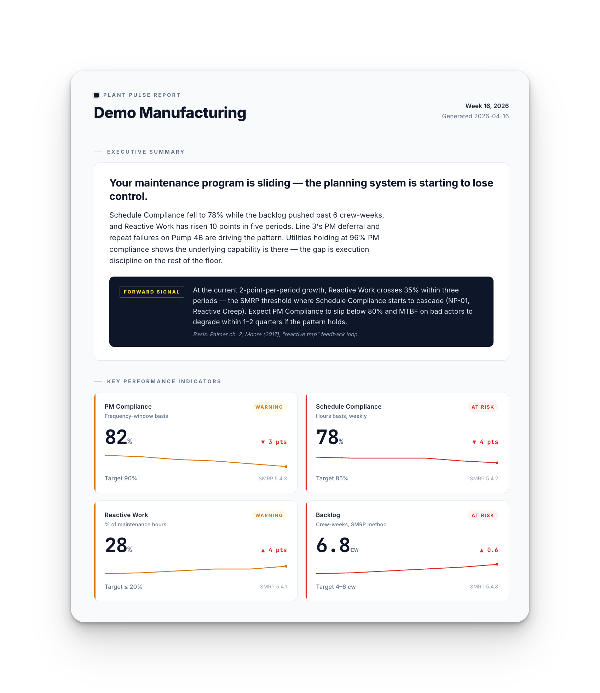

# Plant Pulse Report — a Claude skill for industrial maintenance leaders

Turn your maintenance KPIs into a cited, printable executive briefing in under a minute.

**What it does**: you give it a CSV of your KPIs (PM compliance, schedule compliance, reactive work, backlog, etc.) and a short list of asset-level concerns. You get back a self-contained HTML report with:

- An executive summary that reads like a peer wrote it, not a template
- Four KPI cards with sparklines, status badges, and benchmark citations
- A "Forward Signal" predictive line grounded in reliability literature
- Top-3 prioritized actions with named playbooks (e.g., PB-RX-001 Break the Reactive Spiral)
- Asset-level concern deep-dives with recommended plays
- Backlog aging
- A Sources section with real references (SMRP, Palmer, Moore, Moubray, ISO 14224)
- One-click Download-PDF button

No external dependencies except Google Fonts (falls back to system fonts offline). No AI-invented numbers — every benchmark and playbook traces to a named source.




Open `examples/sample-output.html` for the fully-rendered, interactive version (with the Download PDF button).

---

## Install

1. Copy the `plant-pulse-report/` folder into your Claude skills directory:
   ```
   ~/.claude/skills/plant-pulse-report/
   ```
2. Restart Claude Code (or reload skills in claude.ai).
3. Invoke with `/plant-pulse-report` in any Claude session.

On macOS:
```bash
cp -r plant-pulse-report ~/.claude/skills/
```

On Windows:
```powershell
Copy-Item -Recurse plant-pulse-report $env:USERPROFILE\.claude\skills\
```

---

## Quick start

**Option 1 — interactive (no CSV needed):**
```
/plant-pulse-report
```
The skill walks you through selecting KPIs and entering values.

**Option 2 — from CSV:**
```
/plant-pulse-report --kpi-file kpis.csv --asset-file assets.csv --plant "Acme Plant 3" --period "March 2026"
```

See `examples/kpis.csv` and `examples/assets.csv` for the schema — they're the working inputs that produced `examples/sample-output.html`.

---

## Supported KPIs

12 industrial-maintenance KPIs, each with benchmarks from SMRP Best Practices, Palmer's *Maintenance Planning and Scheduling Handbook*, Moore's *Making Common Sense Common Practice*, Moubray's *RCM II*, ISO 14224, and the US BLS:

- PM Compliance
- Schedule Compliance
- Reactive Work %
- Backlog (crew-weeks)
- MTBF
- MTTR
- OEE
- Wrench Time
- Asset Availability
- MRO Inventory Turns
- TRIR (safety)
- Open Work Orders (non-standardized — flagged as such)

Pick any 4–6 per report. See `benchmarks.md` for the full catalog with world-class / acceptable / at-risk thresholds and source citations.

---

## Playbooks

10 named plays the skill recommends based on KPI patterns:

| Code | Title |
|------|-------|
| PB-PM-001 | Restore PM Compliance |
| PB-SCH-001 | Close the Schedule Compliance Gap |
| PB-RX-001 | Break the Reactive Spiral |
| PB-BL-001 | Control Backlog Growth |
| PB-RF-001 | Eliminate Repeat Failures |
| PB-MRO-001 | Fix Chronic MRO Stockouts |
| PB-PLN-001 | Right-size the Planner-to-Tech Ratio |
| PB-LUB-001 | Strengthen the Lubrication Program |
| PB-PDM-001 | Deploy Condition-Based Maintenance on Bad Actors |
| PB-WRENCH-001 | Increase Wrench Time |

Each has a trigger pattern, 3–5 concrete steps, an expected outcome, and a primary reference. See `playbooks.md`.

---

## Narrative patterns

The skill detects 8 named data patterns (NP-01 through NP-08) and uses them to write the Forward Signal line. Example:

> **NP-01 — Reactive Creep:** Schedule Compliance < 80% AND Reactive % > 35% → expect PM Compliance to fall and MTBF on bad actors to degrade within 1–2 quarters. (Basis: Palmer ch. 2; Moore (2017).)

See `narrative-patterns.md` for all eight.

---

## Exporting

- **PDF** — click the Download PDF button in the top-right corner of the report. Uses your browser's native print-to-PDF. Zero dependencies.
- **PNG** — pass `--enable-png-export` when invoking the skill to add a Download PNG button. This adds one external library (html2canvas via CDN, ~50 KB) to the output. Not included by default because it breaks the "works offline" property.
- **LinkedIn teaser** — pass `--teaser infographic` or `--teaser carousel` to also generate a 1080×1350 portrait version for social sharing.

---

## Sources

The skill cites only these references — nothing invented:

- SMRP Best Practices, 5th Edition (2017)
- Palmer, *Maintenance Planning and Scheduling Handbook*, 3rd ed. (2019)
- Moore, *Making Common Sense Common Practice*, 4th ed. (2017)
- Moubray, *Reliability-Centered Maintenance (RCM II)*, 2nd ed. (1997)
- Nowlan & Heap (1978) — original RCM study
- SAE JA1011 / JA1012 — RCM standards
- ISO 55000 / 55001 — asset management
- ISO 14224 — reliability data
- Wireman, *Benchmarking Best Practices in Maintenance Management* (2004)
- Nakajima, *Introduction to TPM* (1988)
- Hansen, *Overall Equipment Effectiveness* (2001)
- Gulati, *Maintenance and Reliability Best Practices*, 2nd ed. (2012)
- Latino et al., *Root Cause Analysis*, 4th ed. (2011)
- US BLS Injuries, Illnesses, and Fatalities program

Full list with URLs in `references.md`.

---

## About

Built by Ivan Getov. Free to use, share, and modify.

Want more playbooks like these? Subscribe to **The Floor Report** at <https://getov.substack.com> — a weekly briefing for maintenance and reliability leaders, grounded in the same sources this skill cites.

> *I help plants and manufacturing teams perform better by fixing the system, not blaming the people.*

---

## License

MIT-style — use it, share it, modify it. Attribution appreciated but not required (the footer of generated reports already handles this).
